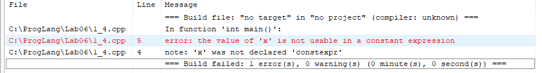

# Языки программирования
## Лабораторная работа №6
### Задание 1

*Рассмотрим следующую программу на C++.*

```cpp
#include <iostream>
#include <cmath>
int main() {
    double x = 0;
    const auto Pi = std::acos(0) * 2;
    std::cout << Pi << std::endl;
    return 0;
}
```

*Проверьте четыре способа объявления Pi.*

* `const auto Pi = std::acos(0) * 2;`
* `constexpr auto Pi = std::acos(0) * 2;`
* `const auto Pi = std::acos(x) * 2;`
* `constexpr auto Pi = std::acos(x) * 2;`

*Что можно сказать об этих вариантах? Проверьте, в каких вариантах объявляется константа этапа трансляции.*

---

### Ответ
* `const auto Pi = std::acos(0) * 2;` Работает. Внутри скобок стоит литерал, поэтому компилятор, скорее всего, посчитает результат заранее. Pi создается как обычная константа, которую нельзя менять.
* `constexpr auto Pi = std::acos(0) * 2;` Работает. Внутри скобок стоит литерал, а команда constexpr строго обязывает компилятор посчитать результат еще при сборке программы. Это константа этапа трансляции.
* `const auto Pi = std::acos(x) * 2;` Работает. Внутри стоит переменная x, значение которой известно только при запуске программы. Поэтому Pi посчитается во время работы программы, а не при компиляции.
* `constexpr auto Pi = std::acos(x) * 2;` Не работает. Слово constexpr требует посчитать всё заранее, но внутри стоит переменная x. Из-за этого компилятор выдаст ошибку, и программа не соберется.

